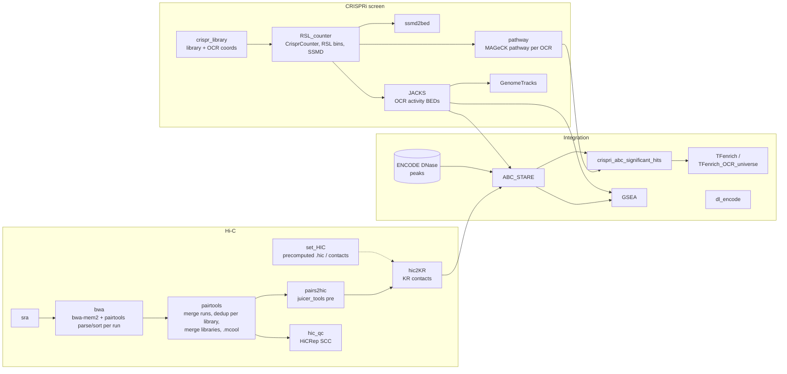

# ocrscreen — CRISPRi screening of open chromatin regions in RWPE-1 and HMEC cells

Code repository for the paper:

> **<CITATION / DOI TBD>**

This repository contains the Snakemake workflow used to analyse pooled CRISPR
interference (CRISPRi) screens that tile open chromatin regions (OCRs) in two
non-transformed human epithelial cell lines, the prostate epithelial line **RWPE-1**
and human mammary epithelial cells (**HMEC**). Guides carry random sequence labels
(RSLs), which are counted per guide and time point (day 4 vs. day 14) with
CrisprCounter. OCR effects are scored with SSMD (RSLC), aggregated per OCR with
MAGeCK pathway (GSEA mode) and, alternatively, with JACKS using RSL bins as synthetic
replicates. OCRs whose perturbation changes cell fitness reproducibly in both screen
replicates are linked to putative target genes with the activity-by-contact (ABC)
model as implemented in STARE, using Hi-C data of the same cell types processed from
raw reads in this workflow, and are tested for transcription-factor binding-site
enrichment with UniBind/LOLA.

## Pipeline overview



## Modules

Modules are enabled with the `modules:` list in the config. A module adds its rules and
its final targets; inputs produced by a module that is not enabled must already exist
(this allows re-running downstream steps without re-running, e.g., Hi-C processing).

| Module | What it does | Key outputs (`results/<CELL>/…`) |
|---|---|---|
| `crispr_library` | Adds OCR coordinates to the sgRNA library; writes headed library | `crispr/library/<CELL>_library{,_coords}.csv` |
| `RSL_counter` | CrisprCounter RSL counting, log2FC table, RSL binning (`rsl_bin_nt`), SSMD (RSLC) | `crispr/RSL_counts/`, `crispr/RSL_binned_counts/`, `crispr/SSMD_score/<SAMPLE>_RSL_SSMD_Score.tsv` |
| `pathway` | Guides grouped per OCR (GMT), MAGeCK pathway (GSEA) on the SSMD ranking; replicate concordance figure | `crispr/mageck_pathway/<SAMPLE>.pathway_summary.txt`, `crispr/SSMD_figures/<CELL>_RSL_SSMD_score.pdf` |
| `ssmd2bed` | SSMD scores as BED (sgRNA and OCR level) | `crispr/SSMD_score/<SAMPLE>_SSMD_score_{sgrna,ocr}.bed` |
| `JACKS` | JACKS on RSL synthetic replicates; CRISPRi enhancer-activity BEDs | `jacks/<CELL>_result_*`, `jacks/enhancer_activity_per_cell{,_filtered}.bed` |
| `GenomeTracks` | pyGenomeTracks plot of CRISPRi activity per configured region | `genome_tracks/<REGION>.png` |
| `sra` | Downloads Hi-C runs from SRA | `hic/fastq/<RUN>_{1,2}.fastq.gz` |
| `bwa` | `bwa-mem2 mem -SP5M` → `pairtools parse` → `pairtools sort`, per run | `hic/runs/<RUN>.sorted.pairs.gz`, `.parse.stats` |
| `pairtools` | Merge runs of a library, dedup per library, per-library stats and QC `.cool`, merge libraries, `.mcool` (balanced) | `hic/libraries/<LIB>.{nodups.pairs.gz,dedup.stats,<res>.cool}`, `hic/<CELL>.merged.nodups.pairs.gz`, `hic/<CELL>.mcool` |
| `pairs2hic` | Merged pairs → `.hic` (juicer_tools pre) | `hic/<CELL>.hic` |
| `hic2KR` | KR-normalised contacts for STARE | `hic/contacts_KR_5000/` |
| `set_HIC` | Use a precomputed `.hic` or contact directory per cell line instead of reads | — |
| `hic_qc` | Optional HiCRep stratum-adjusted correlation between libraries | `hic/qc/<CELL>.hicrep_scc.tsv` |
| `ABC_STARE` | ABC scores + TF affinities (STARE) for each run in `abc_stare.runs` | `abc_stare/<RUN>/<CELL>_<RUN>_ABC_scoredInteractions.txt.gz` |
| `crispri_abc_significant_hits` | Replicate-concordant OCRs (Fisher-combined pathway p, BH) × ABC contacts | `crispri_abc/<CELL>_sig_contacts.tsv`, `<CELL>_sig_CRE_hg19.bed` |
| `GSEA` | GSEApy prerank of ABC target genes of JACKS-significant OCRs | `gsea/<GENE_SET>/gsea_results.tsv` |
| `dl_encode` | Downloads ENCODE tracks (H3K27ac bigWig) | `resources/encode/tracks/` |
| `TFenrich` | UniBind enrichment of significant OCRs vs. UniBind universe | `tfenrich/unibind_universe/allEnrichments.tsv` |
| `TFenrich_OCR_universe` | UniBind enrichment vs. all DNase OCRs of the cell line | `tfenrich/ocr_universe/allEnrichments.tsv` |

### Hi-C processing

Hi-C reads are processed following the 4DN Hi-C data processing pipeline and the
Open2C pairtools/cooler recommendations:

1. each SRA run is aligned with `bwa-mem2 mem -SP5M` and streamed into
   `pairtools parse` (MAPQ ≥ 30, `--walks-policy 5unique`) and `pairtools sort`;
2. runs that belong to the same library (e.g. HMEC library HIC064 = 3 runs) are merged
   with `pairtools merge` **before** deduplication;
3. every library/replicate is deduplicated separately (`pairtools dedup`, duplicates are
   library specific) and gets its own statistics (`pairtools dedup --output-stats`,
   i.e. a `pairtools stats` report) and a QC `.cool`;
4. the deduplicated pairs of all libraries of a cell line are merged (`pairtools merge`),
   binned (`cooler cload pairs`) and zoomified/balanced (`cooler zoomify --balance`);
   the same merged pairs are converted to `.hic` (`juicer_tools pre`) and dumped as
   KR-normalised contacts for STARE.

The run → replicate → cell-line grouping is defined in `config/hic_samples.tsv`.

References: 4DN Hi-C processing pipeline (<https://data.4dnucleome.org/resources/data-analysis/hi_c-processing-pipeline>);
pairtools documentation (<https://pairtools.readthedocs.io>, Open2C et al. 2024, *PLoS Comput Biol* 20:e1012164);
cooler (Abdennur & Mirny 2020, *Bioinformatics* 36:311–316); HiCRep (Yang et al. 2017, *Genome Res* 27:1939–1949).

## Data availability

| Data | Accession / source |
|---|---|
| CRISPRi screen FASTQs (RWPE-1, HMEC) | `<GEO/SRA accession TBD>` |
| sgRNA libraries and OCR coordinate tables | `<supplementary table / Zenodo TBD>` (see `resources/README.md`) |
| RWPE-1 Hi-C (2 replicates) | GEO GSE118514: GSM3358193 (SRR7760386), GSM3358194 (SRR7760387) |
| HMEC Hi-C (in situ, 7 libraries) | GEO GSE63525 (Rao et al. 2014): GSM1551607–GSM1551613 (SRR1658680–SRR1658688); combined map `GSE63525_HMEC_combined.hic` |
| DNase-seq peaks (hg19) | ENCODE/Duke via UCSC `wgEncodeOpenChromDnase` (`Rwpe1Pk`, `HmecPk`) |
| RWPE-1 H3K27ac | ENCODE ENCFF889LYR |
| Gene annotation | GENCODE v48 lifted to GRCh37 (`gencode.v48lift37.annotation.gtf`) |
| UniBind LOLA databases | Zenodo doi:10.5281/zenodo.4161027 (`hg38_robust_UniBind_LOLA*.RDS`) |

## Requirements

- Linux, [Snakemake](https://snakemake.readthedocs.io) ≥ 8 (developed with 9.14), conda/mamba
  (`--use-conda`); Apptainer/Singularity for the UniBind step (`--use-singularity`).
- Tools installed automatically through `workflow/envs/*.yaml`: MAGeCK 0.5.9.5, R 4.3
  (reshape2, plyr), JACKS (git commit dd5c4be), STARE 1.0.5 (`stare-abc`),
  bwa-mem2 2.2.1, samtools 1.21, pairtools 1.1.2, cooler 0.10.4, sra-tools, GSEApy 1.1.10,
  pyGenomeTracks 3.9, UCSC liftOver, OpenJDK.
- External tools/data **not** on conda (see `resources/README.md`):
  - `CrisprCounter.jar` (T. Kivioja; not redistributable — obtain from the authors of
    [CRISPR-pooled-RSL](https://github.com/agata-sm/CRISPR-pooled-RSL)), path in `crispr.crisprcounter.jar`;
  - [unibind_enrichment](https://bitbucket.org/CBGR/unibind_enrichment) (script + container) and the UniBind LOLA databases;
  - the screen FASTQs, sgRNA libraries and OCR coordinate tables.
- Downloaded automatically when needed: hg19 FASTA, GENCODE GTF, liftOver chain,
  STARE PSEM, DNase peaks, `juicer_tools_1.22.01.jar`, `run_JACKS.py`, SRA runs.

Resource needs are large for the Hi-C part (~1.07 billion HMEC and ~0.94 billion RWPE-1
read pairs; building the bwa-mem2 hg19 index needs roughly 90 GB RAM; juicer_tools pre is
run with a 48 GB heap).

## Installation

```bash
git clone <repository URL> ocrscreen && cd ocrscreen
mamba create -n snakemake -c conda-forge -c bioconda 'snakemake>=8' && conda activate snakemake
# place private inputs as described in resources/README.md, then check:
snakemake -n --configfile config/config.yaml
```

## Quick start

```bash
# full analysis (both cell lines, all modules)
snakemake --use-conda --use-singularity --cores 32 --configfile config/config.yaml
```

### Running a subset of modules

Edit `modules:` in `config/config.yaml`, or override it on the command line:

```bash
# CRISPRi screen only
snakemake --use-conda --cores 8 --configfile config/config.yaml \
  --config 'modules=["crispr_library","RSL_counter","pathway"]'

# Hi-C processing only
snakemake --use-conda --cores 32 --configfile config/config.yaml \
  --config 'modules=["sra","bwa","pairtools","pairs2hic","hic2KR"]'

# a single target file
snakemake --use-conda --cores 4 results/RWPE/crispr/mageck_pathway/RWPE_R1.pathway_summary.txt
```

To use the published HMEC map (as in the original analysis) instead of reprocessing the
HMEC reads, add `set_HIC` to `modules` and set
`cell_lines.HMEC.precomputed_hic: resources/hic/GSE63525_HMEC_combined.hic` (downloaded
from GEO automatically). A precomputed KR contact directory can be given with
`precomputed_contacts`.

All configuration keys are documented in [`config/README.md`](config/README.md).

## Output layout

```
results/
├── <CELL>/
│   ├── crispr/        library, RSL counts, binned counts, SSMD, MAGeCK pathway, figures
│   ├── jacks/         JACKS results and CRISPRi enhancer-activity BEDs
│   ├── genome_tracks/ pyGenomeTracks ini + plots
│   ├── hic/           fastq/, runs/, libraries/, merged pairs, .mcool, .hic, contacts_KR_5000/, qc/
│   ├── abc_stare/     one directory per ABC run (STARE output + stable scored interactions + BEDPE)
│   ├── crispri_abc/   significant OCR–gene contacts and significant-OCR BED
│   ├── gsea/          GSEApy prerank results per gene-set library
│   └── tfenrich/      UniBind enrichment (UniBind universe and OCR universe)
└── logs/
resources/             downloaded references and tools (see resources/README.md)
```

## Paper figures

The figure panels were drawn in Jupyter notebooks that are not part of this
repository. The table lists the workflow outputs the notebooks read
(panel-level mapping to be completed by the authors).

| Figure | Content (from notebook) | Workflow outputs |
|---|---|---|
| Fig. 1 | SSMD replicate concordance, OCR enrichment, RWPE/HMEC overlap | `crispr/SSMD_score/*_RSL_SSMD_Score.tsv`, `crispr/mageck_pathway/*.pathway_summary.txt` |
| Fig. 2 | `<TBD>` | `<TBD>` |
| Fig. 3 | Promoter vs. enhancer contacts of significant OCRs, shared genes, gene-set enrichment, genome tracks | `abc_stare/dnase/*_ABC_scoredInteractions.txt.gz`, `crispri_abc/*_sig_contacts.tsv`, `crispr/library/*_library_coords.csv`, `resources/encode/tracks/RWPE_H3K27ac_ENCFF889LYR.bigWig` |
| Fig. 4 | UniBind TF-enrichment bubble plots | `tfenrich/unibind_universe/allEnrichments.tsv`, `tfenrich/ocr_universe/allEnrichments.tsv` |
| Suppl. | `<TBD>` | `<TBD>` |

## License

The workflow code is released under the [MIT License](LICENSE). Two vendored scripts
derived from [RSLC](https://github.com/zhjilin/RSLC) —
`workflow/scripts/IRA-SSMD_modded.R` and `workflow/scripts/bin_truncated_rsl_counts.pl` —
remain under GPL-3.0-or-later (see their headers). The CrisprCounter properties
template in `resources/` comes from CRISPR-pooled-RSL (MIT, © 2022 Agata Smialowska).

## Contact

Eirik Høye — eirikhoye@gmail.com
